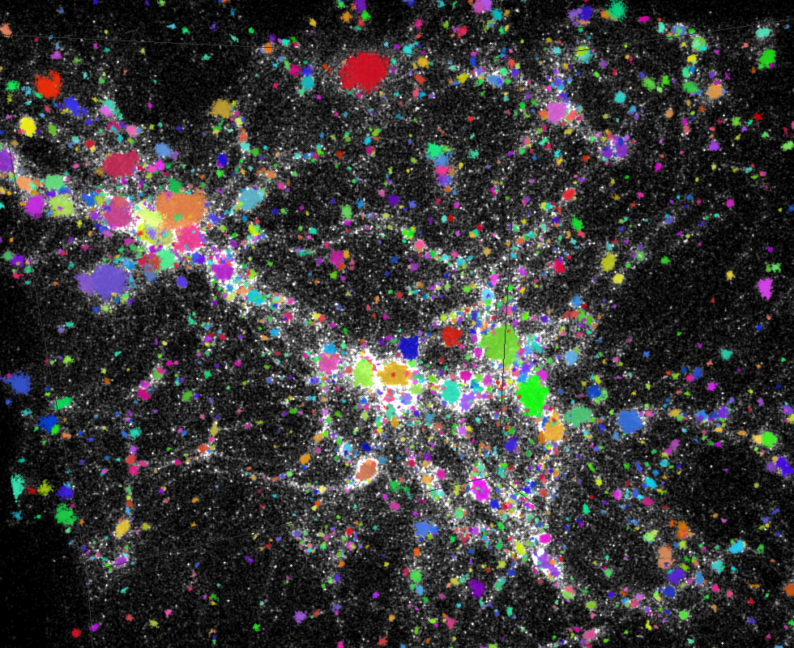
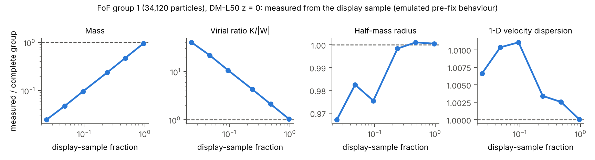

# CosmoViewer

**Gadget · EAGLE · AGORA · SWIFT compatible**

**Explore a simulation in 3D, pick out the structures that matter, follow them through time, and measure them, without the selection losing its meaning along the way.**

CosmoViewer is an interactive workbench for particle simulations of the universe. It brings 3D visualisation, structure finding, particle tracking, quantitative analysis and movie making into one window, all of it unit-correct and queryable in real-time, and connects them through one shared model of what you have selected. It reads single- and multi-file HDF5 snapshots from every version of Gadget and most N-body and SPH codes, including EAGLE, AGORA and SWIFT runs, along with their group catalogues.



CosmoViewer is research software under active development, written in Python and released under the GNU GPL v3.

**[Worked example: following a galaxy through a merger (PDF)](docs/Following_a_galaxy_through_a_merger.pdf)** · [A session](#a-session) · [Why CosmoViewer](#why-cosmoviewer) · [What it does](#what-it-does) · [Getting started](#getting-started) · [Data and validation](#data-and-validation) · [Known limitations](#known-limitations) · [Under the hood](#under-the-hood) · [AI Disclosure](#ai-disclosure) · [Credits and license](#credits-and-license)

## A session

Open a folder of simulation output. The snapshots line up on a time slider.

Fly into a galaxy merger. Below the 3D view, a smoothed map of exactly what you are looking at redraws to follow the camera. Hide the dark matter and the stars and gas stand alone. Zoom from the whole system down to a single clump, and the detail fills in where you look.

Click a clump of gas and follow it through the merger. When gas turns into stars, it stays selected.

Or, explore the filamentary convergence of dark matter over time. Find the haloes in seconds, matching the simulation code's own catalogue. Click the biggest, press *Analyse ▸*, and its profile, mass and energies are computed for exactly those particles, in the same window. Drag the time slider back, and the halo dissolves into the thin web of matter it grew from, still highlighted.

Then keep it. Export the result, or a Python script that reproduces it. Save the selection. Make a labelled movie of the whole thing.

No scripts. No exported particle lists. No guessing whether the particles you measured are the ones you saw.

## Why CosmoViewer

A simulation hands you hundreds of snapshots, each with millions or hundreds of millions of particles, every one carrying a position, a velocity, a mass, an ID and a list of physical properties. The data are rich. The difficulty is turning them into answers. Where are the haloes? What is this one's density profile? What happened to its matter between redshift 3 and today? Which gas became stars?

Usually those questions are answered in two ways that rarely meet. A **viewer** shows the particles: you see a filament, a merger, an odd clump. **Scripts and notebooks** measure them: you fit a profile, you check a mass. Between the two sits a hand-off, and it is clunky. You export a selection, re-read the snapshot in a script, and trust that what you measured is what you saw. Often the script has to be adapted, or written from scratch, and an afternoon goes on it.

Asking the universe a question should not cost an afternoon of scripting.

The switch costs more than time. Curiosity works in the moment: you notice something odd and want to know why, now. When every question needs twenty minutes of setup, most of them never get asked.

The hand-off is also where errors creep in, and the worst of them produce a convincing picture and a convincing but incorrect number:

- **The picture is a sample.** No laptop draws every particle of a large snapshot. Select a halo on screen and you may get only the drawn fraction of its particles. Its radius and velocity dispersion still look right. Its mass and energies come out wrong, and a halo with a quarter of its true mass still looks plausible. Scripts avoid this by cutting a sphere or box from the full snapshot, but a box only approximates the structure you picked out, and it has to be redone by hand for every question.
- **The meaning drifts.** You find a halo, group 12 in the catalogue. Step back a snapshot, look up group 12, and you get a different object, because groups are renumbered by size at every snapshot. "Where was this halo?" and "where were these particles?" sound alike, but they have different answers.
- **Units are easy to get wrong.** Gadget writes distances in Mpc/*h*, measured in an expanding frame. Forget the *h* and every size is off by about 1.5. Nothing breaks; the numbers are just wrong. Silent errors are pernicious, the hardest to catch, and oftentimes ruin papers and lead researchers astray.

Interactive viewers such as GadgetViewer, SPLASH, Firefly and Gaia Sky let you see and select structure, then leave the measuring to scripts. Analysis frameworks such as yt, pynbody and swiftsimio measure at full resolution with units, but have no interactive 3D selection loop. Most of CosmoViewer's individual algorithms have prior art.

What is genuinely new is the model underneath. CosmoViewer keeps three things apart that most tools blur together: **the population** (the particles actually in the simulation), **the representation** (the sample or projection drawn on screen) and **the selection** (the particles you mean to measure). A selection is a population that carries its own meaning and completeness, kept strictly apart from what is drawn. I built CosmoViewer around one rule:

> **What you see may be sampled, smoothed or interpolated, but what you measure never is.**

In plain terms, a rendering approximation can never silently become the population a calculation uses. In practice:

- **Measurement reads the full snapshot.** The 3D view draws a level-of-detail sample; FoF, group selection, tracking and analysis read full-resolution data from the snapshot files. The rule exists because of a real bug: an early version of the analysis view showed a 1-in-15 sample count under the label "Count".
- **A selection is a population with a record.** A bare list of IDs cannot say what it meant or whether it is complete. Each selection stores its ParticleIDs with how it was made, on which snapshot, how many members it should have and whether it has them all. One made from the drawn sample is marked incomplete, and every analysis of it says so.
- **Meaning holds across time.** At another snapshot, a selection means the same particles, found by ID, and it is re-evaluated only when you ask. The picture holds too: the display sample is keyed on a hash of each ParticleID, so it never flickers between frames and the same particles are drawn in every snapshot.
- **Seeing and measuring are one step apart.** *Analyse ▸* sends the selection, record and all, to the analysis view; *Show in 3D* brings it back, highlighted.

The result is continuity of scientific intent. You start with a question, such as what happened to the gas in this region as the galaxies merged, and as you change views, select, step through time and measure, the question you are answering stays the same one.

## What it does

Five things, in the order you usually need them. Every feature is described in full, with what it is for, in [docs/FEATURES.md](docs/FEATURES.md).

### See

- **Dual-domain view.** 3D on top, 2D below, always showing the same region. The 2D panel draws a slice of points (like an MRI scan, the default), a smoothed surface-density map, or a colour-aware projection of whatever you are colouring by, with the same colour table and range. It redraws when the camera stops, so you explore in 3D and read the structure in 2D at the same moment.
- **Level of detail.** A fixed budget of points, from 500k to 5M (default 2M), is spent where you look, and the focus reaches full resolution as you zoom. Snapshots larger than memory still open, because detail streams from disk: an 850-million-particle EAGLE snapshot is explored on a laptop.
- **Shading you control.** Only the person making a figure knows what it is for. Colour by type, any property, group or where each particle started. Fix the colour range so frames stay comparable, or type your own for reproducibility. Give coloured and uncoloured particles their own size, blur and fade: colour a dark-matter or AGORA run by FoF group and every halo lights up, but you lose the macro structure, until you click *Show uncoloured particles*, and BAM: adjust their transparency and you see everything.
- **Layers and overlays.** Each particle type gets a checkbox, a colour and its count, so dark matter can be hidden to let the stars and gas stand alone. A scale bar, the time or redshift and labelled points are drawn over the view and burnt into screenshots.

### Find

- **Friends-of-Friends.** A halo finder from the *Structures* menu, with Gadget-4's conventions (*b* = 0.2, at least 32 members), run on every particle in its own process so it cannot freeze the viewer. It refuses a run that will not fit in memory, and asks you for a linking length on an isolated run. On runs from other codes (EAGLE, AGORA, Gadget-2/3, zoom-ins) the default linking length does not work yet; type one in as described in [docs/fof_linking_length.md](docs/fof_linking_length.md).
- **The code's own answers.** Load the catalogue your simulation wrote and use its groups and subhaloes directly; *Check against catalogue* measures a group from its own particles and compares the count, mass and centre with what the catalogue says. Catalogues are read in the Gadget-4 HDF5 format.
- **Halo table.** Every group with its size, mass and centre. Click a row and the whole group is selected and the camera flies to it.

### Follow

- **Selections that remember.** Select by group, sphere, property range, ID list or a click, in up to six selection sets, each with its own colour. Each one keeps its record wherever it goes.
- **Tracking by ID.** Step to any snapshot and the same particles are found again at full resolution, even after gas has become stars. This answers a question about matter: where did these particles come from? Which halo they belong to at another time is a separate question, answered by running FoF or loading the catalogue there.
- **Particle inspector.** Click a particle and it is read from every loaded snapshot: every property, how it changed since the previous or first snapshot, whether it changed type, and the history of any property, exportable as CSV. *List top* finds the 200 most extreme particles of whatever you are colouring by.
- **Follow and trace.** The camera can ride along with a selection, and trails draw where its particles went, unwrapped across the periodic box.

### Measure

- **One tab away.** Analysis lives in a tab of the same window. *Analyse ▸* sends the selection; a bar above every result says what was measured and whether anything is missing.
- **The measurements.** 24 quantity plugins (density, temperature, entropy, metallicity in solar units, element abundances, stellar and black-hole properties) and one for any numeric field; radial profiles with the softening-limited radius marked; Lagrangian radii with error bars; kinetic, thermal and potential energy and the virial ratio; mass-weighted phase diagrams.
- **Checks.** A sanity report runs nine families of checks for broken data, so a problem in the files is caught before it reaches a result.
- **Results leave as code.** Export CSV, or a Python script that reproduces the result from the snapshot, so the GUI is never a dead end for a paper.

### Show

A good simulation movie usually takes a pipeline. CosmoViewer has two movie makers, and both start from the view already on screen.

- **Quick** makes a movie in under a minute of setup: turn around the current view or play through the snapshots, pick a length, a size and MP4 or GIF, and it writes that one file, with time, scale bar and colour bar burnt in.
- **Custom** is for the movie that has to be right: keyframed camera paths through space and time, points or smoothed density with one colour range for the whole movie, PNG frames plus MP4 and GIF, snapshots read from disk as it renders, and every setting saved so it can be remade.
- **Smooth time (experimental).** In-between frames follow a cubic Hermite path through each particle's positions and velocities, matched by ID. They are entirely for viewing, as acceleration is usually non-linear: every one is labelled, and none feeds a measurement.

## Getting started

### What you need

- **Python 3.10 to 3.14**, on macOS or Linux. Check with `python3 --version`.
- **A graphics driver with OpenGL**, which every recent Mac and most Linux desktops already have.
- **About 16 GB of RAM** for comfortable work on large runs. Smaller machines work with a lower particle budget.

CosmoViewer was developed and tested on a 16 GB Apple M3 Mac, and also tested on a Linux VM.

### 1. Get the code

```bash
git clone <repository-url> CosmoViewer
cd CosmoViewer
```

### 2. Make a virtual environment

This keeps CosmoViewer's packages apart from the rest of your system.

```bash
python3 -m venv .venv
source .venv/bin/activate
```

Run `source .venv/bin/activate` again in every new terminal before you launch CosmoViewer.

### 3. Install the Python packages

```bash
pip install --upgrade pip
pip install "PyQt6>=6.5" "pyqtgraph>=0.13" "PyOpenGL>=3.1" "numpy>=1.24" \
            "h5py>=3.8" "scipy>=1.10" "astropy>=5.0"
```

| Package | What it is for |
|---|---|
| PyQt6 | The window, menus and panels |
| pyqtgraph | The 3D view and the plots |
| PyOpenGL | The point shaders and stereo |
| NumPy | Every array |
| h5py | Reading HDF5 snapshots and catalogues |
| SciPy | Neighbour searches, smoothing and FoF |
| Astropy | Units and cosmology |

### 4. Optional: movie encoding

Movies are written as PNG frames without anything extra. For MP4 and GIF, add one of these:

```bash
brew install ffmpeg                 # macOS, with Homebrew: MP4 and GIF
sudo apt install ffmpeg             # Debian or Ubuntu: MP4 and GIF
pip install imageio-ffmpeg          # or: a bundled ffmpeg, no system install
pip install opencv-python           # or: MP4 through OpenCV
pip install Pillow                  # GIF without ffmpeg
```

### 5. Linux only: system libraries for Qt

A desktop Linux usually has these already. On a minimal install, or if PyQt6 fails with an error such as `libEGL.so.1: cannot open shared object file`, install them (Debian or Ubuntu names):

```bash
sudo apt install libgl1 libegl1 libxkbcommon-x11-0 libxcb-cursor0 libfontconfig1 libdbus-1-3
```

### 6. Check the install

```bash
python -c "import PyQt6.QtGui, pyqtgraph, OpenGL, numpy, h5py, scipy, astropy; print('ready')"
```

If it prints `ready`, everything is in place.

### 7. Launch

Open a folder of snapshots, a single file, or a glob pattern:

```bash
cd "Cosmoviewer Immersive"
python main.py /path/to/simulation/output
python main.py /path/to/output/snapshot_050.hdf5
python main.py "/path/to/output/snapshot_*.hdf5"
```

Naming one piece of a multi-file snapshot opens all of its pieces. Useful options:

| Option | What it does |
|---|---|
| `--list` | Print what would be opened, then exit without a window |
| `--max-particles N` | Set the particle budget (default 2,000,000); lower it on a small machine |
| `--run COMMAND` | Run a console command after loading, such as `--run info`; repeatable |

You can also launch with no arguments and use *File ▸ Read simulation snapshot*.

### 8. A first session

1. Open *Structures ▸ Halo table* and click a group.
2. Press *Analyse ▸* and pick an analysis, such as *Profile*.
3. Move the time slider. The same particles stay selected.
4. Press *Export* for a CSV or a Python script.

The analysis view also runs on its own:

```bash
cd "Dataset Explorer"
python density_explorer.py /path/to/output/snapshot_050.hdf5
```

It takes `--dataset GROUP/FIELD` (for example `PartType0/Density`) and `--tab Histogram|Line|Matrix` to open a field straight away, and `--set SET.hdf5` to restrict its analyses to a saved selection.

### If something goes wrong

- **`ModuleNotFoundError`:** the virtual environment is not active. Run `source .venv/bin/activate` from the `CosmoViewer` folder.
- **PyQt6 cannot load a library (Linux):** install the system libraries in step 5.
- **The view is black or very slow:** lower the budget with `--max-particles 500000`, or from the *Particle budget* menu.
- **MP4 or GIF is greyed out in the movie maker:** none of the encoders in step 4 is installed. PNG frames are still written, and the log gives the ffmpeg command to encode them later.
- **Any other error:** the *Log & console* tab shows the full message and traceback.

## Data and validation

| Format | Status and evidence |
|---|---|
| Gadget HDF5 snapshots | Supported; tested on Gadget-4 output |
| Other N-body and SPH codes writing Gadget-style HDF5 | Supported |
| Multi-file HDF5 snapshots (`*.N.hdf5`) | Supported; tested on a 16-file EAGLE snapshot |
| EAGLE / OWLS field names | Supported |
| AGORA snapshots | Supported; opened routinely by the author |
| SWIFT snapshots | Supported; verified by the author |
| FoF and subhalo catalogues, Gadget-4 HDF5 format | Supported |
| Gadget binary formats 1 and 2 | Fallback reader; not recently tested |

No simulation data ships with CosmoViewer. It was developed and validated on:

| Dataset | What it is | Source |
|---|---|---|
| DM-L50-N128 | Dark matter only, 128³ particles, 50 Mpc/*h* box, *z* ≈ 3, 1, 0, with FoF catalogues | Gadget-4 example, run locally |
| CollidingGalaxiesSFR | Two disc galaxies merging, with gas and star formation; 335 snapshots | Gadget-4 example, run locally |
| EAGLE Ref-L0025N0752, *z* = 0 | 850 million particles in 16 files (58 GiB) | EAGLE public release |

Against Gadget-4's own output:

| Test | Data | Result |
|---|---|---|
| FoF membership | DM-L50-N128 | *z* = 0: 2,774 of 2,774 groups identical. All three snapshots: 8,030 of 8,032; the two differences are float32 ties at the linking length |
| FoF group numbering | DM-L50-N128, *z* = 0 | Same order up to rank 120; equal-sized groups swap beyond that |
| Group mass and centre | All three DM-L50-N128 catalogues | Agree to float32 rounding |
| Energies vs `energy.txt` | CollidingGalaxiesSFR, *t* = 0 | Kinetic and thermal energy and mass per type agree to all 8 printed digits |
| Sanity report | DM-L50-N128, *z* = 0 | Flags the two particles sitting exactly on the box edge; nothing else |

Against analytic models and independent code:

| Test | Result |
|---|---|
| Lagrangian radii, Plummer spheres (*N* = 10⁴, 100 realisations) | 93–98 % within 2σ of the analytic values (95.4 % expected) |
| Virial ratio *K*/\|*W*\|, Plummer spheres (*N* = 10⁵, 20 realisations) | 0.4996 ± 0.0002 (0.5 expected) |
| Radial profiles, Plummer and Hernquist | Residuals match sampling noise; a planted anisotropy β = 0.75 is recovered |
| Sanity report, 15 planted defects | All 15 caught |
| Phase diagram, CollidingGalaxiesSFR | Every bin matches an independent h5py calculation to 10⁻¹² |

Performance:

| Measurement | Result | Machine |
|---|---|---|
| Zooming through EAGLE *z* = 0 (850M particles) | 1.5–2.0M of a 2M budget drawn, from the whole box down to 0.01 of it; full resolution at the focus by 0.004 of the box | Linux VM on the MacBook (4 cores, 3.9 GB RAM), 8M-particle store; re-measured on the native M3 with the 16M store |
| Memory while zooming fast, same snapshot | 3.5–4.0 GB peak across all processes, 1.7–2.2 GB idle | 16 GB Apple M3 MacBook, macOS |
| FoF on DM-L50-N128 *z* = 0 (2.1M particles) | About 10–11 s, about 0.5 GB | 4-core Linux machine |

Methods are in [PERFORMANCE.md](Cosmoviewer%20Immersive/PERFORMANCE.md). Every comparison, with the command that reproduces it, is in [docs/VALIDATION.md](docs/VALIDATION.md).

To run the tests:

```bash
cd "Cosmoviewer Immersive" && QT_QPA_PLATFORM=offscreen python -m pytest tests -q
cd "Dataset Explorer"     && QT_QPA_PLATFORM=offscreen python -m pytest -q
```

Tests that need real data are skipped by default. To run them against local copies of DM-L50-N128 and CollidingGalaxiesSFR:

```bash
verification/run_real_suites.sh <data_root> <scratch_dir> both
```

`<data_root>` must hold `DM-L50-N128/output` and `CollidingGalaxiesSFR/output` as real copies of the files.

## Known limitations

- Above 200 million particles, no ParticleID index is built, so tracking falls back to a slower scan.
- The Gadget binary (format 1 and 2) reader is a fallback and has not been tested recently.
- Field histograms and tables always show the whole snapshot, even when a selection is active.

The full list, with where each limit lives in the code, is in [docs/LIMITATIONS.md](docs/LIMITATIONS.md).

## Under the hood

CosmoViewer sits on base libraries only: PyQt6 for the interface, pyqtgraph and PyOpenGL for drawing, NumPy, SciPy and h5py for data, and Astropy for units. There is no analysis framework underneath: the scientific and workflow components are written for CosmoViewer. The tests were mostly machine-generated, and most have been sanity-checked by hand; the comparisons with Gadget-4 output, analytic models and planted defects above are the stronger evidence. Before publication the code went through a major refactor, and many experimental features were cut to keep it stable; see Section X. <!-- TODO: replace "Section X" with a link to the section on cut experimental features once it is written. -->

| Component | What it does |
|---|---|
| Snapshot I/O | Finds and reads single- and multi-file HDF5 snapshots and group catalogues; takes units from the files |
| Friends-of-Friends | Grid-based group finder that runs in its own process, so it cannot freeze the viewer |
| Level of detail | Draws a fixed budget of particles, chosen by ParticleID, densest where you look; streams the rest from disk |
| Tracking | Finds the same particles in any snapshot from an on-disk ParticleID index |
| Rendering | GPU point sprites and smoothed (SPH) density maps |
| Movies | Camera paths and smooth in-between frames from particle velocities |
| Analysis | Plugin pipeline for profiles, radii, energies and checks, with caching and script export |
| Selection sets | One file format for selections, shared by both views |

### Why the drawn sample is never measured



Measure a halo from a fraction of its particles and its size and velocity dispersion barely move, but its mass falls with the fraction and its virial ratio climbs. The picture looks right. The numbers are wrong. So the 3D view draws a sample, and every measurement reads the full snapshot.

### What a selection records

| Field | Meaning | Example |
|---|---|---|
| `kind` | How it was made | `group`, `region`, `query`, `ids` |
| `definition` | Its parameters | FoF group 1, *b* = 0.2, minimum size 32 |
| `defined_at` | The snapshot it was made on | file, index, time, redshift |
| `complete` | Whether it holds every member | yes / no / unknown |
| `incomplete_reason` | Why not | made from the drawn sample |
| `n_expected` | How many members it should have | 34,120 |

At another snapshot a selection means the same particles, found by ID. A FoF selection on a snapshot without FoF gives a clear message. Editing an incomplete set by hand does not make it complete.

### Units

Conventions come from the file itself, because most unit errors come from a setting that no longer matches the data. Values are converted with the unit attributes in each file (`a_scaling`, `h_scaling`, `to_cgs`), and whether a run is comoving is read from its header. Where the file cannot settle a question, CosmoViewer asks; FoF on an isolated run, for example, needs a linking length you type in. Where a file states no units, values are labelled "assumed". Gadget-4's solar mass is 3.0 × 10⁻⁴ larger than the IAU value; reported masses use the IAU one.

### Documentation

| Document | Contents |
|---|---|
| [docs/FEATURES.md](docs/FEATURES.md) | Every feature in detail |
| [docs/VALIDATION.md](docs/VALIDATION.md) | Every validation result and how to reproduce it |
| [docs/LIMITATIONS.md](docs/LIMITATIONS.md) | Limitations and future work |
| [architecture/](architecture/README.md) | Algorithms, methodology and figures |
| [ARCHITECTURE.md](ARCHITECTURE.md) | Components, data flow and design |
| [PERFORMANCE.md](Cosmoviewer%20Immersive/PERFORMANCE.md) | Level of detail and performance measurements |
| [docs/PARTICLE_SELECTION.md](docs/PARTICLE_SELECTION.md) | The Particle Selection panel, control by control, with hand-test workflows |
| [docs/SMALL_SET_TRACKING.md](docs/SMALL_SET_TRACKING.md) | Following a few hand-picked particles through time |
| [docs/MOVIES.md](docs/MOVIES.md) | The Quick and Custom movie makers, tracking in movies, in-between and smoothed frames |
| [measurements/README.md](Dataset%20Explorer/measurements/README.md) | Analysis measurements |

### Repository layout

```
Cosmoviewer Immersive/   3D viewer and main application (main.py)
  controller/            application logic
  views/                 windows, panels and dialogs
  lod/                   level of detail
  snapshot_io/           snapshot and catalogue I/O, FoF, ParticleID index
  model/                 tracking, SPH projection, colour tables
  movie/                 movie maker
  tests/
Dataset Explorer/        analysis view (density_explorer.py)
  measurements/          profiles, Lagrangian radii, energies, sanity, phase diagrams
  *_plugin.py            quantity plugins
  test_*.py
verification/            standalone verification scripts
cosmo_io_engine/         Gadget binary readers
```

## AI Disclosure

CosmoViewer was conceived, designed and directed by Arpit Pratap Singh over about a year and a half, beginning with research into the data structures and parsing methods that large simulation files demand. AI coding assistants were used throughout for the routine work of writing code line by line. Arpit decided how the system is organised, what each selection records, which unit and cosmological conventions apply and how every result is validated, and led the bug-fixing, tracing faults through the comparisons with Gadget-4 output and analytic models described above. All key logic and helper files were verified by hand, as were most of the tests.

## Credits and license

- The viewer's interaction model (persistent selection sets, recentring on a selection, rotating and evolving movies) follows [GadgetViewer](https://github.com/jchelly/gadgetviewer) by John Helly.
- Friends-of-Friends: Davis et al. (1985), with the conventions of Gadget-4 (Springel et al. 2021).
- Level-of-detail sampling uses the splitmix64 hash (Steele, Lea & Flood 2014).
- SPH smoothing uses the M4 cubic-spline kernel (Monaghan & Lattanzio 1985).
- Centring methods: Power et al. (2003), Casertano & Hut (1985), Bai & Breen (2008).
- Test models: Plummer (1911), Aarseth, Hénon & Wielen (1974), Hernquist (1990).
- Colour maps: Matplotlib (viridis family), cividis, CET (Kovesi) and Turbo, as bundled with pyqtgraph.
- Data: Gadget-4 (Springel et al. 2021); EAGLE (Schaye et al. 2015; Crain et al. 2015; McAlpine et al. 2016; The EAGLE team 2017).
- Libraries: PyQt6, pyqtgraph, PyOpenGL, NumPy, SciPy, h5py, Astropy.

CosmoViewer is released under the [GNU General Public License v3.0](LICENSE).
