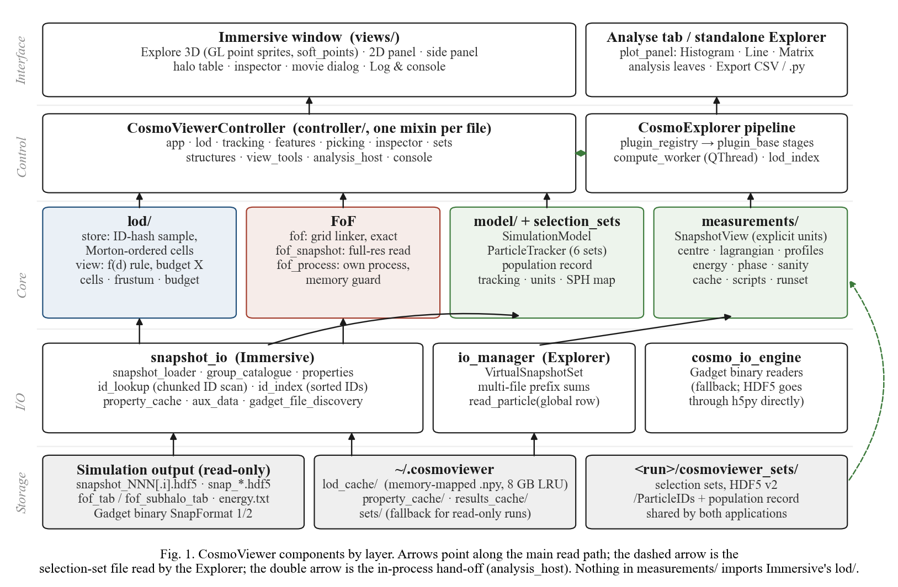
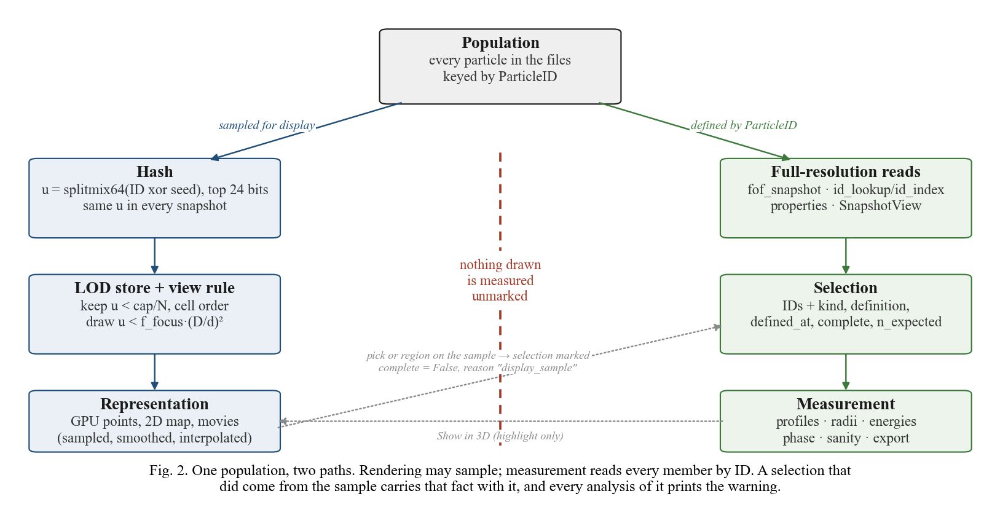

# architecture/

How CosmoViewer is put together, what it computes and how its results were checked. The repository's top-level
[ARCHITECTURE.md](../ARCHITECTURE.md) is the short tour; this folder is the long one.

| File | What is in it |
|---|---|
| [ALGORITHMS.md](ALGORITHMS.md) | Every method, with equations, constants and the file it lives in: units, level of detail, FoF, tracking, measurements, the Explorer's histogram index, smoothed images and movies |
| [figures/](figures/) | Eight figures, each as vector PDF and PNG (list below) |
| [src/make_figures.py](src/make_figures.py) | Regenerates every figure from the code and the bundled test snapshot |
| [notes/](notes/) | Working notes, kept as they were written |

## Figures

| | Figure | Built from |
|---|---|---|
| 1 | [Components by layer](figures/fig01_architecture.pdf) | the package layout |
| 2 | [One population, two paths](figures/fig02_two_paths.pdf) | the representation / selection split |
| 3 | [Selection-set file](figures/fig03_selection_schema.pdf) | `selection_sets.py`, format version 2 |
| 4 | [Level-of-detail rule](figures/fig04_lod_rule.pdf) | `lod/view.py`, `lod/store.py`, run on 400,000 real ParticleIDs |
| 5 | [FoF on real data](figures/fig05_fof_real_data.pdf) | `snapshot_io/fof.py` against Gadget-4's `fof_tab_002` |
| 6 | [Import graph](figures/fig06_module_graph.pdf) | the `import` statements of Immersive Mode, read with `ast` |
| 7 | [Performance on EAGLE](figures/fig07_performance.pdf) | the measurements in `PERFORMANCE.md` |
| 8 | [Tracking](figures/fig08_tracking.pdf) | `id_lookup.py`, `id_index.py` |





To rebuild them (needs matplotlib, which is not a CosmoViewer dependency):

```bash
pip install matplotlib
python architecture/src/make_figures.py
```

## Reading order

For the design, start with Fig. 2, then ALGORITHMS §4 (selections) and §2 (level of detail). For the science, start
with [docs/VALIDATION.md](../docs/VALIDATION.md) and ALGORITHMS §3 and §5. For the code, Fig. 1 and Fig. 6 show where everything lives.
