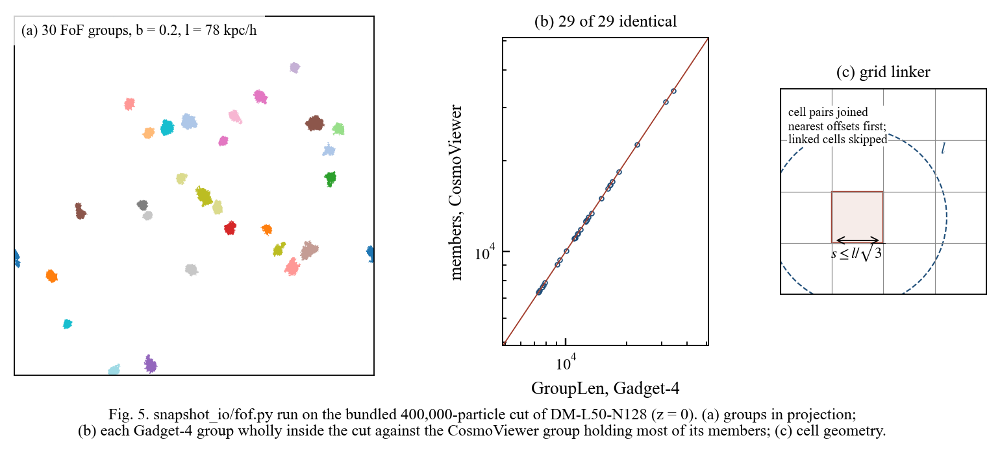

# Validation

What CosmoViewer computes, checked against something that does not share its code: the simulation code's own
output, analytic models, and independent h5py scripts. Every number below can be reproduced from this repository;
the command is given with each table.

## Friends-of-Friends against Gadget-4

**On the data that ships with the repository.** The 400,000-particle cut of DM-L50-N128 at z = 0 in
`_dev_tools/inspector_check/dm_cut` holds the largest groups of Gadget-4's catalogue whole. CosmoViewer's linker
(b = 0.2, l = 78.125 kpc/h, at least 32 members) finds them all:

| Catalogue groups wholly inside the cut | Identical in size in CosmoViewer | Groups found |
|---:|---:|---:|
| **29** | **29** | 30 (the 30th is the group cut off at the edge of the sample) |

```bash
pip install matplotlib
python architecture/src/make_figures.py      # prints the FoF line; draws architecture/figures/fig05_fof_real_data.pdf
```



**On the full run** (DM-L50-N128, 128³ particles, Gadget-4 `fof_tab_000` to `_002`), from
`verification/fof_vs_catalogue.py` and the real-data test suite, both run on 1 Nov 2026:

| Snapshot | z | Groups, Gadget-4 / CosmoViewer | Particles in groups, Gadget-4 / CosmoViewer | Largest group | Time |
|---|---:|---:|---:|---|---:|
| 002 | 0 | 2,774 / 2,774, **every size identical** | 968,775 / 968,775 | 34,120, **identical members** | 9.0 s |
| 001 | ≈ 1 | 3,033 / 3,033 | 647,737 / 647,736 | 10,709, identical members | 10.4 s |
| 000 | ≈ 3 | 2,225 / 2,225 | 240,438 / 240,429 | 2,852, identical members | 11.5 s |

At z = 0 the member sets are identical one to one for all 2,774 groups
(`tests/test_real_fof_vs_catalogue.py::test_fof_partition_equals_gadget4_catalogue`). Group numbers differ only
between groups of equal length, from rank 121 on, where the order of ties is arbitrary. At z ≈ 1 and z ≈ 3 the
handful of particles that differ are explained by float32 ties: every split is at a gap between l and l plus four
float32 spacings (`tests/test_fof_gadget4.py::test_membership_matches_gadget4`). Both tests pass.

```bash
python verification/fof_vs_catalogue.py <output>/snapshot_002.hdf5 <output>/fof_tab_002.hdf5
verification/run_real_suites.sh <data_root> <scratch_dir> immersive
```

## Measurements against Gadget-4's energy log and catalogues

| Quantity | Reference | Result | Test |
|---|---|---|---|
| K, U and mass per type | CollidingGalaxiesSFR `energy.txt`, row 0 | equal to all 8 printed digits | `test_profiles_energy_sanity.py::…::test_sfr_snapshot_000_equals_energy_txt` |
| Kinetic energy, cosmological | DM-L50-N128 `energy.txt`, interpolated to the snapshot time | within 5 × 10⁻⁴ | `…::test_dm_kinetic_energy_matches_energy_txt` |
| Group mass and centre | `GroupMass`, `GroupPos` | agree to float32 rounding (all three catalogues in the original check; the test checks DM-L50 z = 0) | `test_structures.py::test_real_dm_l50_catalogue_membership_and_check` |
| Total mass | Ω₀ ρ_crit (L/h)³ with Gadget's G and H₀ | 1.00000 | `…::test_dm_snapshot_002_edge_particles` |

## Measurements against analytic models

Plummer and Hernquist spheres are sampled, written as Gadget-4-style HDF5 files and read back through the normal path.

| Quantity | Model | Expected | Result | Test |
|---|---|---|---|---|
| Virial ratio K/\|W\| | Plummer, N = 10⁵, 20 realisations | 0.5 | 0.4996 ± 0.0002 | `test_plummer_virial_ratio_at_1e5` |
| Lagrangian radii, 2σ coverage | Plummer, N = 10⁴, 100 realisations | 95.4 % | 93–98 % | `test_coverage_n1e4`, `test_coverage_n1e5` |
| Density and σ_r profiles | Plummer, 8 seeds × 20 bins | pulls mean 0, spread 1 | ≈ 0 and ≈ 1 | `test_plummer_density_sigma_and_isotropy` |
| Density profile | Hernquist | within errors | within errors | `test_hernquist_density` |
| Anisotropy β | planted β = 0.75 | 0.75 | recovered | `test_planted_anisotropy` |
| Surface density | projected Plummer | within errors | within errors | `test_surface_density_of_projected_plummer` |

## Checks against independent code and planted defects

| Check | Result | Test |
|---|---|---|
| Phase diagram, CollidingGalaxiesSFR snapshot 100 | every bin equal to an h5py-only computation to 10⁻¹² | `test_rho_T_equals_independent_h5py` |
| Sanity report, 15 planted defects | 15 of 15 caught, each by its own check only | `TestSanityPlantedDefects` |
| Sanity report, DM-L50-N128 z = 0 | flags exactly the two particles with z = BoxSize; nothing else | `test_dm_snapshot_002_edge_particles` |
| Exported script | reproduces the window's CSV digit for digit | `test_*_script_reproduces_the_window` |
| Selection by sphere, merger walkthrough | 99,577 particles, identical ID set to an h5py read | [worked example](Following_a_galaxy_through_a_merger.pdf) |

## Test suites on 1 Nov 2026

Python 3.14.3, macOS, Qt offscreen; real data: DM-L50-N128 snapshots 000–002 and CollidingGalaxiesSFR snapshots
000, 100, 101, 102, 200 and 334.

| Suite | With real data | Without |
|---|---|---|
| Immersive Mode | 380 passed, 2 skipped | 345 passed, 33 skipped |
| Dataset Explorer | 220 passed | 190 passed, 30 skipped |

The two remaining skips need an EAGLE snapshot and one large-budget case.

What this page does not cover is listed in [LIMITATIONS.md](LIMITATIONS.md).
